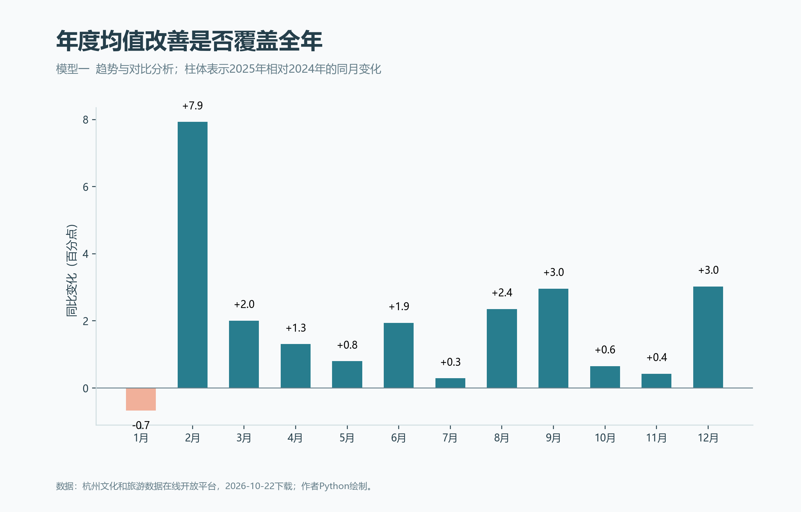
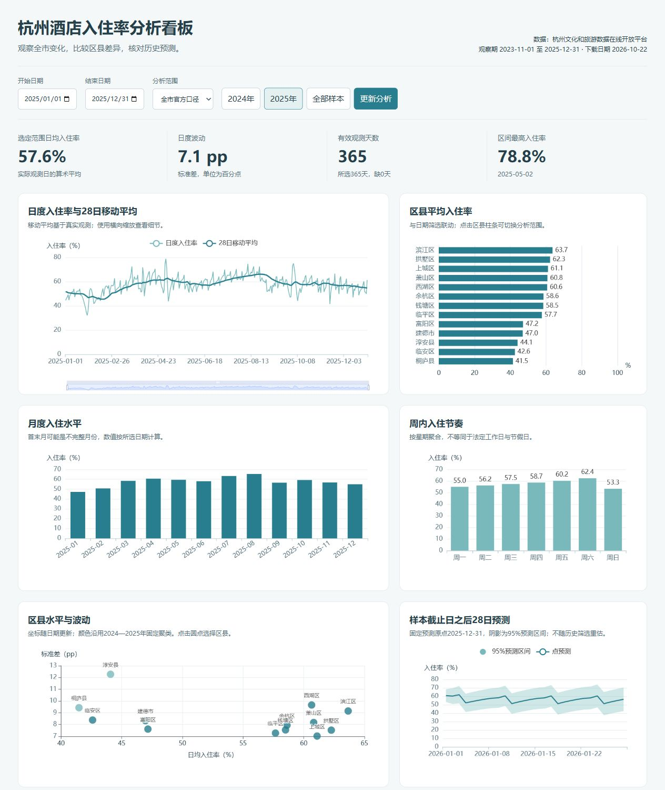

# 杭州酒店入住率分析与预测

《商业数据分析》期末个人课程项目。作者：曹俊男，数据科学学院，大数据241，学号2024459985112。

使用杭州公开的城市和区县日度入住率，分析年度与周内变化、区县特征分群及28日预测。项目包含论文、完整数据与代码、**10种教材格式复现图、6张业务模型图、1个Pyecharts联动大屏**。本次作品全部使用杭州数据新生成，平时作业旧图不计入数量。

## 查看成果

- 提交论文（Word）：[2024459985112_曹俊男_杭州酒店入住率分析与预测.docx](docs/2024459985112_曹俊男_杭州酒店入住率分析与预测.docx)
- 提交论文（PDF）：[2024459985112_曹俊男_杭州酒店入住率分析与预测.pdf](docs/2024459985112_曹俊男_杭州酒店入住率分析与预测.pdf)
- 大屏：`outputs/dashboard/index.html`，双击即可离线运行。
- [大屏操作演示视频（MP4，约1分13秒）](outputs/dashboard/大屏操作演示.mp4)：年度对比、区县筛选、条形图与散点联动、预测区间、明细及CSV导出。
- 全部图表：`outputs/figures`，PNG为220 dpi，同时提供SVG。
- 计算结果及图表索引：`outputs/tables`。
- 作业逐项核对与改进建议：`docs/作业要求核对.md`。




## 复现

实际验证环境为Windows、Python 3.13。建议在Python 3.11或以上的独立环境安装固定版本依赖。

```bash
python -m pip install -r requirements.txt
python run_all.py
```

整个流程读取已经归档的原始文件，不发起网络抓取。运行后会重建清洗表、结果表、全部图表、大屏和Word论文，并执行独立检查。Pyecharts使用已归档的ECharts资源，断网也可查看大屏。默认使用Windows微软雅黑或黑体；其他系统需安装兼容中文字体，避免缺字。

Word自动生成不依赖Microsoft Word。PDF渲染与版式核验使用本机Word完成，不是`run_all.py`的跨平台依赖；已生成论文可直接阅读。浏览器截图与演示视频是实际操作留档，不由复现脚本重建。视频于2026-11-03录制，仅包含大屏页面，无音频；连续采集的画面按真实时间戳编码，段间等待已剪去，操作时间和筛选状态见`outputs/dashboard/大屏操作演示_操作记录.json`。

论文文件名按“学号_姓名_题目”统一，实际输出文件名记录在`outputs/tables/paper_metadata.json`。重新生成前请关闭该Word文件，避免文件占用导致写入失败。

## 课程提交

电子成果为上述Word或PDF论文及本公开仓库链接：https://github.com/YDZ-R/CDA-homework。仓库同时提供原始与清洗数据、Python代码、结果图表、离线大屏、实际演示截图和MP4视频。纸质版打印上述PDF或Word；课程要求截止时间为2026年11月5日11:00，如课程群另有调整，以最新通知为准。

## 数据来源与使用条件

唯一主数据源为**杭州文化和旅游数据在线开放平台**。查询入口：
https://data.wgly.hangzhou.gov.cn/home/#/dataPlatform/ssDatabase

获取日期：**2026-10-22**。获取方式是在官方页面选择全市或杭州区县、酒店入住率、所有档次、每日和日期范围，点击“下载→下载原始数据”，保存官方Excel。未使用爬虫、网页解析或模拟登录收集数据。来源平台说明数据来自PMS、OTA等预订入住数据。

原始全市文件822条，区县文件10294条。为与网页说明的2023-11-01起点一致，剔除全市2023年10月的31条记录，正式主表**791条真实日度观测**，区县表10294条，涉及13个区县。数据截止**2025-12-31**。每条记录是某范围某一天的汇总，不能解释为一家酒店或一笔订单。

全市缺2023-11-18，上城与临安同日缺失。历史统计只使用真实观测；预测专用日历表用过去同星期均值补1天，并保留`observed`标记。该补值不计入主表真实记录数。所有入住率均在0至100之间，无重复键。IQR异常值只标记，未删除真实峰谷。

数据受[来源平台服务条款](https://data.wgly.hangzhou.gov.cn/home/ToS.pdf)约束：免费、非排他使用，不得有偿售卖；引用注明来源及下载日期；衍生分析须表明为个人研究，并继续保留来源协议约束。条款原件已保存到`docs/杭州平台服务条款.pdf`。本仓库不将数据重新许可为不受限制的开放数据，也不代表发布平台作官方判断。

## 模型与验证

1. **趋势与对比**：月度环比、同月同比、完整年度比较、星期均值。入住率差使用百分点，另输出相对变化百分比。
2. **K-Means**：2024—2025年区县均值、标准差、周末差和季节幅度标准化，比较k=2、3、4；最小组不少于2，按轮廓系数选择；种子241，50次初始化。另做逐一移除特征的敏感性检查。
3. **SARIMA**：预先指定3个低阶候选，仅用2025-09-11至10-08的28日验证期选型，测试期为2025-10-09至12-31，连续3轮28日滚动回测。与重复最近7日模式的周季节朴素法比较，输出点预测、95%预测区间、RMSE、MAPE及MAE。

回测SARIMA的RMSE为3.38个百分点、MAPE为4.93%；朴素法分别为7.83个百分点、10.45%。95%预测区间在84个测试观测上的覆盖率为100%，也提示区间可能偏宽。最终对2026-01-01至01-28的预测以2025-12-31为固定历史原点，**不是当前的实时预报**，没有用这28天尚未取得的实际值再次评分。

区县聚类仅是13个区县的探索性画像，对季节幅度特征较敏感。数据缺少酒店容量、收入及顾客ID，不推导订单人数、利润、RFM或用户留存，不用区县简单均值替代全市官方序列。

## 图表索引

|编号|类型|名称或模型|
|---|---|---|
|fig01|模板|对比柱形图|
|fig02|模板|对比折线图|
|fig03|模板|带均值柱形图，六区均值|
|fig04|模板|标注柱形图|
|fig05|模板|柱形折线图|
|fig06|模板|蝴蝶图|
|fig07|模板|对比滑珠图|
|fig08|模板|平滑折线图，含年份色带|
|fig09|模板|单值圆环图|
|fig10|模板|南丁格尔圆环图，入住率分组天数占比|
|fig11、fig12|业务|月度同比及周内变化|
|fig13、fig14|业务|区县聚类与特征热力图|
|fig15、fig16|业务|滚动回测与未来28日区间预测|
|fig17|辅助|研究技术路线|

10种模板逐一对应郭宏远《Excel数据可视化 从图表到数据大屏》配套第二章工作表9、13、2、4、23、6、30、11、14和20，所有数值均来自本次杭州数据。模板的红蓝折线、均值黄线、八色数值框、镜像条形、滑珠轨道、年份色带及渐变圆环由Python重新绘制。业务图采用简洁白底，不在图内堆叠数据来源或方法说明；必要说明集中在论文正文及本README。

## 大屏操作

日期、年度和区域筛选联动更新KPI、日度趋势、月度图、周内图、区域对比、波动散点与明细表。点击区域柱或散点可选择区县。导出按钮生成当前范围的CSV。固定原点的历史预测单独显示，不会随筛选伪装为重新训练。

## 目录与个人分工

```text
data/raw                 官方原始Excel
data/clean               CSV、JSON、SQLite及预测标记表
scripts/01_load.py        来源与字段核验
scripts/02_clean.py       清洗与缺日处理
scripts/03_analysis.py    三类模型及回测
scripts/04_visuals.py     10模板图、6业务图、1流程图
scripts/05_dashboard.py   Pyecharts离线大屏
scripts/06_paper.py       保留学校模板生成论文
scripts/07_check.py       数据、预测、作品和文档检查
outputs/figures           PNG与SVG
outputs/tables            结果、误差、审计与索引
outputs/dashboard         大屏及本地资源
docs                     论文、学校模板、数据条款与声明
run_all.py               一键复现
```

个人项目，不涉及组员分工。OpenAI Codex参与要求分析、数据核验辅助、代码与论文初稿生成、可视化和润色，论文第7.3节作如实披露。作者需在课程提交前理解并复核最终成果。

仓库：https://github.com/YDZ-R/CDA-homework
